# Ücret Hesaplama

Kurumların **yıllık maaş bütçesini**, **zam çalışmasını** ve **ay ay işveren maliyetini** hesaplayan,
tarayıcıda çalışan bir program. Maliyet bir mini bordroyla çıkar: netten brüte (ya da brütten nete), SGK işçi/işveren payları,
kümülatif gelir vergisi, damga vergisi, asgari ücret istisnası, BES ve teşvikler (05510, 05746 AR-GE, 14857
engelli, 15510 emekli).

Bordro, İK ve finans ekipleri için yazıldı. Kurulum gerektirmez: internetsiz çalışır, veriyi tek bir
(isteğe bağlı şifreli) dosyada tutar.

> **Sorumluluk notu.** Program bütçe ve öngörü içindir; resmî bordronun yerine geçmez. Yasal parametreler
> (asgari ücret, gelir vergisi dilimleri, SGK oranları, teşvik oranları, sakatlık indirimi) her yıl resmî
> kaynaktan kontrol edilmelidir. Kurulumla 2026 değerleri gelir.

## Neler yapar

- **Gruplar ve çalışmalar.** Bütçe, kurumun belirlediği gruplar için ayrı ayrı tutulur (ör. Ofis, Üretim).
  Bir grubun bir yılı bir "çalışma"dır. Onaylanan çalışma kilitlenir; parametreleri de onay anındaki hâliyle
  dondurulur. Sonradan "revize" açılabilir.
- **Net ya da brüt bütçe.** Her çalışma açılırken ücret esası seçilir: maaşlar **net** girilir (brüt hesaplanır) ya da
  **brüt** girilir (net hesaplanır). Yeni yıl, kopya ve revize kaynağın esasını devralır; personeli olan çalışmanın
  esası değiştirilemez ve esası farklı çalışmalar arasında kişi taşınmaz. Böylece yıllar arası karşılaştırmada önceki
  yıl maaşı ile yeni maaş hep aynı esastadır; işveren maliyeti iki esasta da aynı formülle çıkar.
- **Zam öngörüsü.** Maaş kademesine göre oran: alt eşiğin altına üst oran, üst eşiğin üstüne alt oran, arada
  doğrusal geçiş. İsteğe bağlı olarak performans çarpanı da uygulanır; yönetim kişi bazında düzeltme girebilir.
- **Hızlı düzenleme.** Personelin temel tanımları (bütçe bölümü, yaka, giriş-çıkış, hesaplama türü, kanun, teşvik, sakatlık,
  BES, zam ayı, performans) kişi kartının yanı sıra doğrudan tablodan, kutularla değiştirilir.
- **Mini bordro.** Kişi × ay maliyet tablosu ve her kişi için 12 aylık bordro dökümü.
- **Aylık girdiler.** Ayni yardım, prim, mesai, yakıt, çalışılan gün, AR-GE günü; yıl içinde hesaplama türü
  ya da kanun değişikliği.
- **Yeni yıl.** Yasal parametre öngörüsü (açıklanmamış asgari ücret ve dilimler için artış oranı) ve önceki
  yılın zamlı maaşlarından yeni çalışma.
- **Performans değerlendirmesi.** Amir puanları, bölüm katsayısı ve zam çarpanı. Gelen model bir
  **örnektir**; kriterleri ve ağırlıkları ekrandan kendi politikanıza göre değiştirin.
- **Mesai öngörüsü.** Bölüm × ay mesai saati.
- **Personel listesini içe alma.** Elinizdeki Excel / CSV listesi ya da ERP / bordro programı çıktısı başlık adlarıyla
  tanınır; hazır listesi olmayan için ekrandan **örnek Excel şablonu** indirilir (Personel İçe Aktarma).
- **Excel.** Bütçenin Excel raporu ve yönetimin düzeltmelerinin geri yüklenmesi; performans ve mesai şablonları.
- **Başlangıç gezisi.** İlk girişte, parametrelerin kontrolünden yedeğe kadar ilk yapılacakları ekran ekran gösteren
  kısa bir rehber açılır; sol alttaki **Başlangıç Gezisi** düğmesiyle yeniden başlatılır.
- **Kullanıcılar.** Rol yerine kişi bazında yetki ve grup erişimi; işlem kaydı; hareketsizlikte otomatik çıkış.
- **Veri güvenliği.** İsteğe bağlı şifreleme (AES-256-GCM, paroladan PBKDF2 ile anahtar), otomatik ve elle
  yedek, aynı anda birden çok kişi ya da sekme açtığında yazma kilidi.

### Tanımlar ekrandan düzenlenir

Kurumdan kuruma değişen her tanım kod değiştirmeden, ekrandan girilir:

| Ne | Nerede |
|---|---|
| Asgari ücret, gelir vergisi dilimleri, SGK tavanı, damga vergisi, BES ve teşvik oranları, sakatlık indirimi | Parametreler (yıl bazında) |
| Mesai katsayıları (hafta içi / hafta sonu), günlük çalışma saati, AR-GE günü eşiği, zam yuvarlama adımı | Parametreler → Genel |
| Zam kademesi (eşikler, oranlar), performans puanı → çarpan kademesi | Parametreler; gruba özel kademe Bütçe Çalışmaları → ✎ |
| Performans değerlendirme modeli: amirler, kriterler, ağırlıklar, ek puan kuralları | Performans Değerlendirme → Değerlendirme modeli (yıl bazında) |
| Hesaplama türleri (SGK oranları), kanun / teşvik türleri | Tanımlar |
| Gruplar, bütçe bölümleri | Tanımlar |
| Dış listenin (ERP / bordro programı) sütun başlıkları | Tanımlar → İçe Aktarma Başlıkları |
| Ücret esası (net / brüt) | Yeni Çalışma penceresi; personel girilmemişse Bütçe Çalışmaları → ✎ Çalışma Ayarları |
| Çalışmaya özel gün, AR-GE günü, 05510 oranı, yuvarlama | Bütçe Çalışmaları → ✎ Çalışma Ayarları |
| Kullanıcılar, yetkiler, otomatik kapanma süresi | Kullanıcılar, Sistem |

Bilerek kodda kalanlar: teşvik ve sigorta kollarının formülleri (adları ve oranları düzenlenir), yaka türleri (beyaz /
mavi), 30 günlük ay ve üç sakatlık derecesi (tutarları düzenlenir), yetki anahtarları.

## Kısa tur

Görüntülerdeki gruplar, kişiler ve tutarlar örnek veridir (uydurma).

**1. Özet.** Seçili grubun yıllık maliyeti, önceki yıla göre farkı, zam miktarı ve ay ay işveren maliyeti. Üst
çubuktan yıl ve grup seçilir; **Tümü** grupları birlikte özetler.

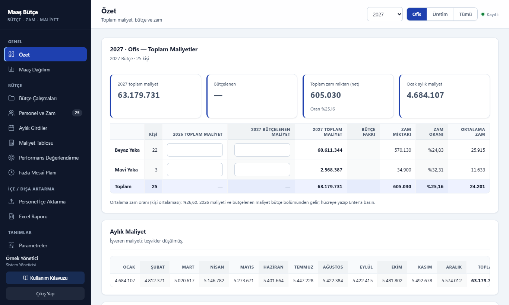

**2. Bütçe çalışması açın.** Her grubun her yılı bir çalışmadır: önceki yılın zamlı maaşlarından, aynı yılın
kopyasından ya da boş açılır. Ücret esası (net / brüt) burada seçilir. Kesinleşen çalışma onaylanınca kilitlenir.

<table><tr>
<td width="58%">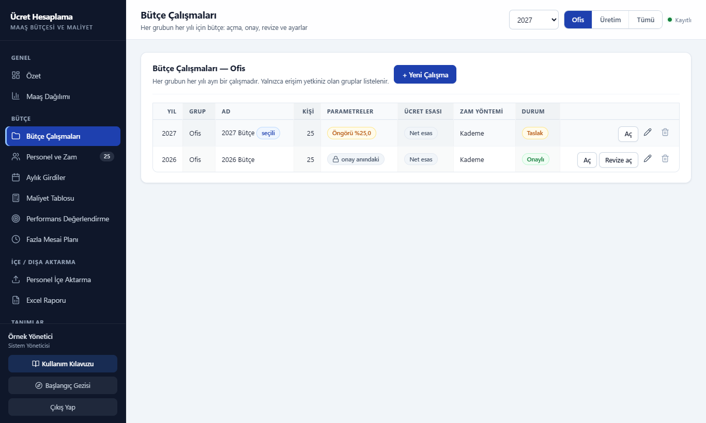</td>
<td width="42%">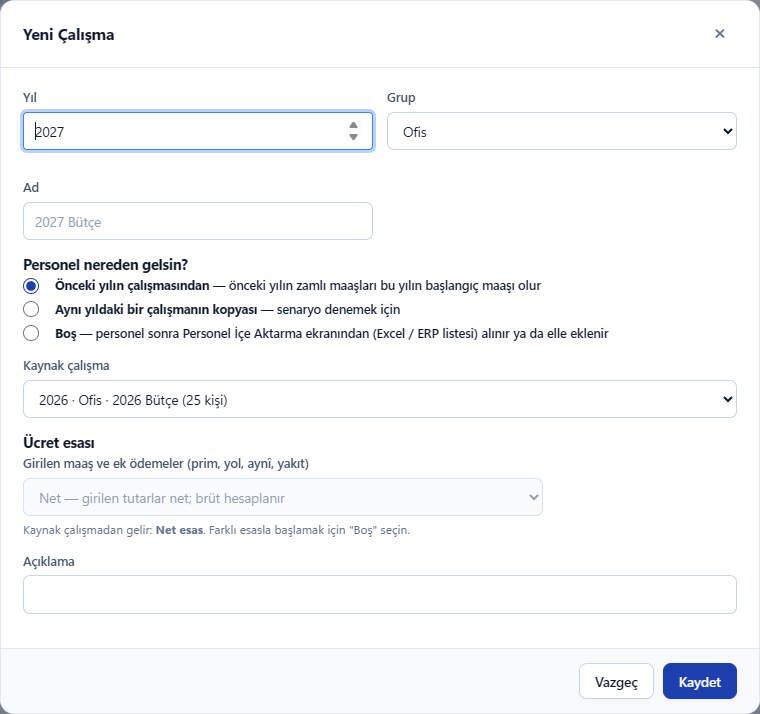</td>
</tr></table>

**3. Personel ve zam.** Her satır bir kişinin bütçesidir: önceki yıl maaşı, kademeye göre öngörülen zam, yönetimin
sarı **Düzeltme** sütununa yazdığı ek ve sonuçta yeni maaş ile yıllık maliyet. Üstteki kutular her değişiklikte
hemen güncellenir.

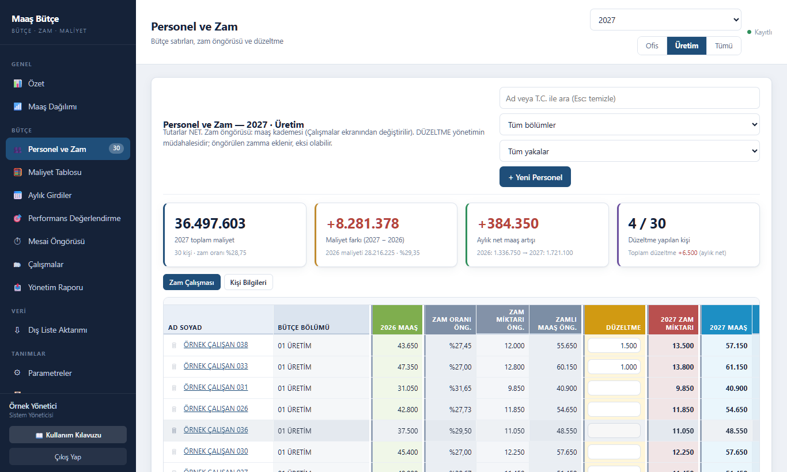

**4. Kişi bilgileri.** Yaka, giriş-çıkış tarihi, hesaplama türü, kanun / teşvik, sakatlık, BES ve zam ayı kişi
kartını açmadan, doğrudan tablodaki kutulardan değiştirilir.

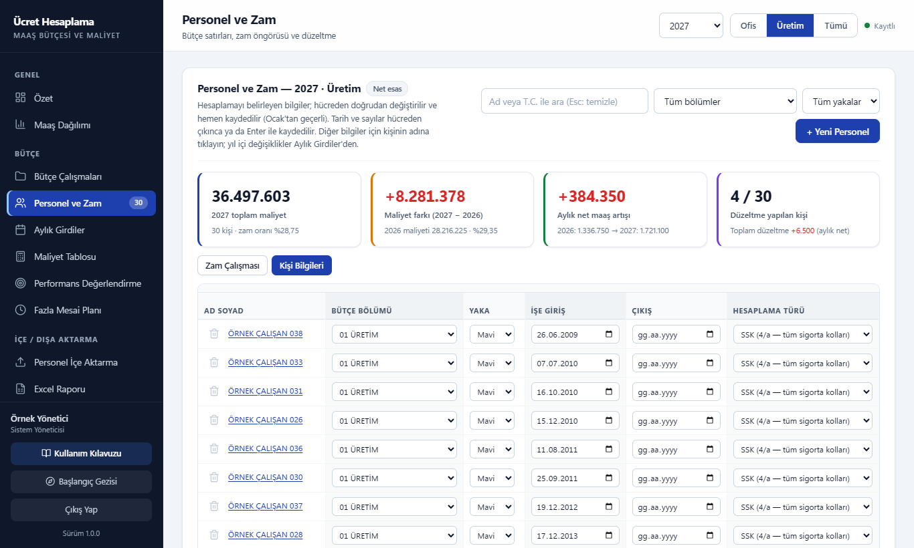

**5. Maliyet ve bordro dökümü.** Kişi × ay maliyet tablosu; kişinin adına tıklayınca ay ay brüt ücret, SGK, gelir
ve damga vergisi, teşvik ve işveren maliyeti dökümü açılır.

<table><tr>
<td width="56%">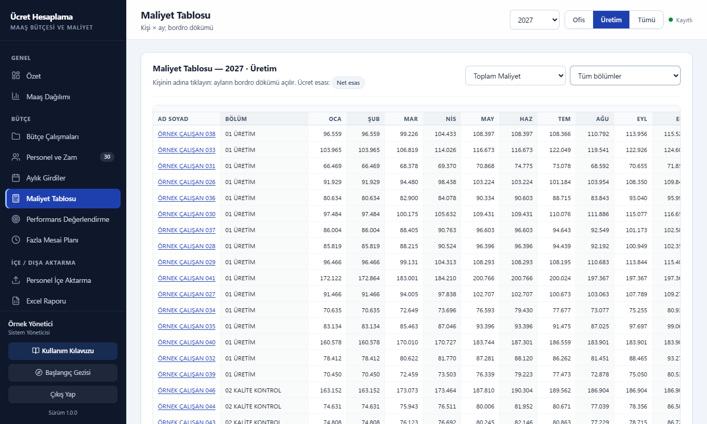</td>
<td width="44%">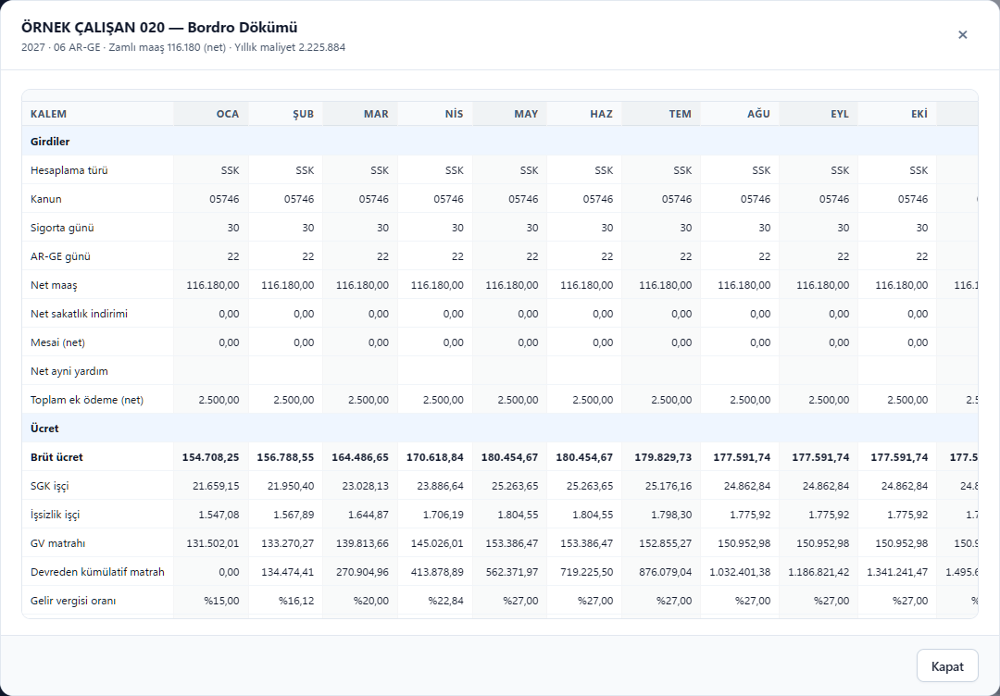</td>
</tr></table>

**6. Maaş dağılımı.** Maaş aralıklarına göre kişi sayısı, toplam maaş ve maliyet; zam kademesinin eşiklerini
belirlerken kullanılır.

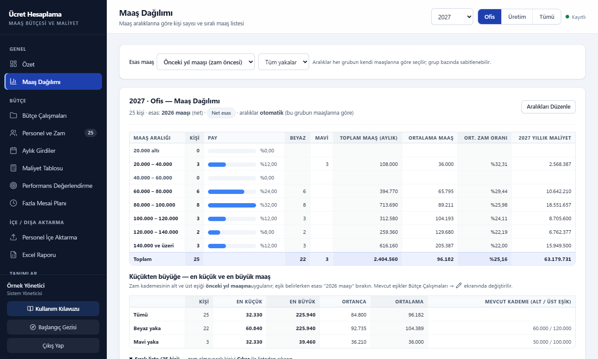

**7. Parametreler ve Excel raporu.** Asgari ücret, vergi dilimleri, SGK ve teşvik oranları yıl bazında ekrandan
girilir; açıklanmamış yıl için artış oranıyla öngörü yapılır. Bütçe yönetime Excel olarak gider, düzeltmeler aynı
dosyadan geri alınır.

<table><tr>
<td width="50%">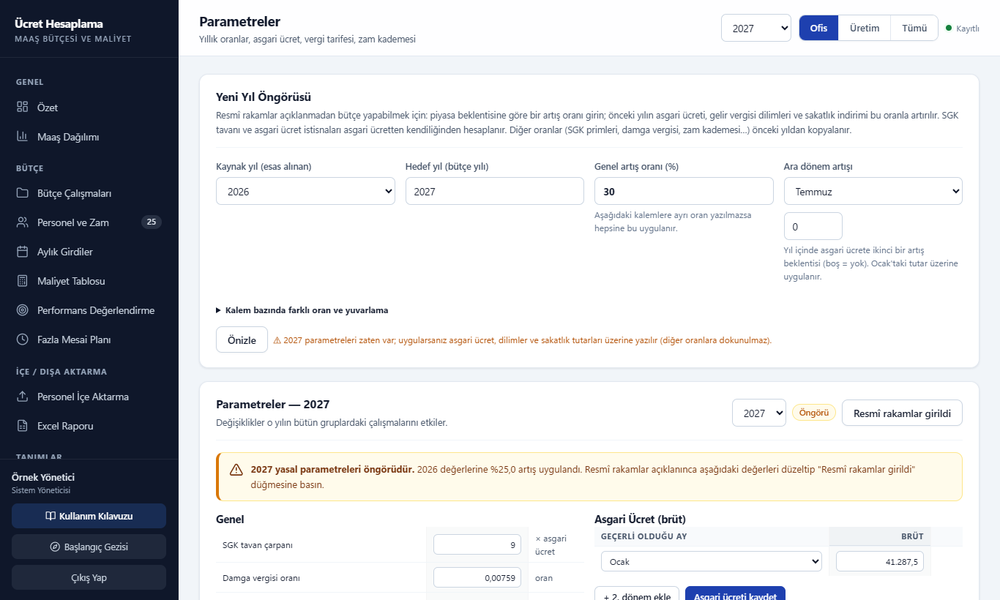</td>
<td width="50%">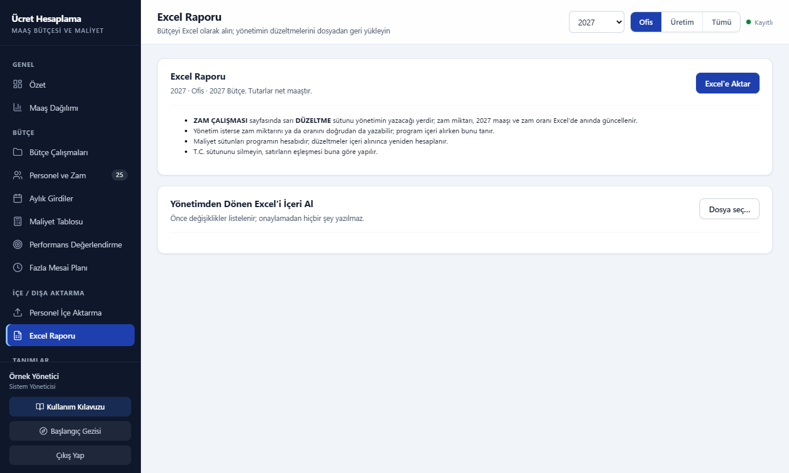</td>
</tr></table>

**8. Başlangıç gezisi.** İlk girişte ilk yapılacakları ekran ekran gösteren kısa bir rehber açılır; programın
içinde ayrıntılı bir **Kullanım Kılavuzu** da vardır.

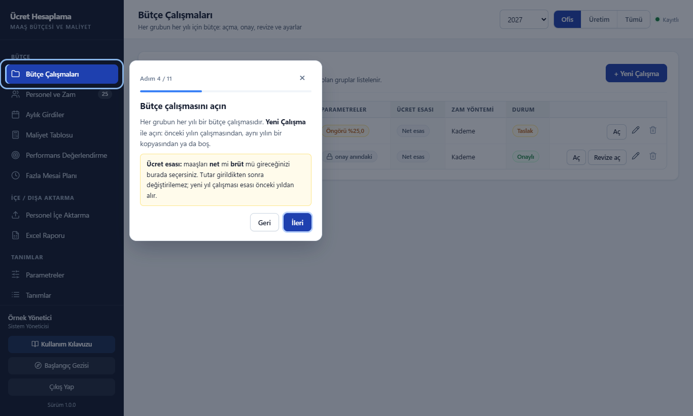

## Kurulum ve kullanım (Windows)

Gereken: Windows 10 / 11 (Windows PowerShell zaten yüklüdür) ve güncel bir tarayıcı (Chrome, Edge, Firefox).
Kurulum programı ya da internet bağlantısı gerekmez.

**1. İndirin.** Bu sayfanın üstündeki yeşil **Code** düğmesi → **Download ZIP**.

**2. Çıkarın.** ZIP dosyasına sağ tıklayıp **Özellikler**'i açın; altta **"Engellemeyi kaldır"** kutusu varsa
işaretleyip Tamam deyin (internetten inen dosyalarda Windows'un uyarı çıkarmasını azaltır). Sonra **Tümünü ayıkla**
ile kalıcı bir yere çıkarın, örneğin `C:\UcretHesaplama`. Masaüstü ya da İndirilenler yerine sabit bir klasör seçin:
verileriniz bu klasörün içinde tutulur.

**3. Başlatın.** `program` klasöründeki **`BUTCE-BASLAT.bat`** dosyasına çift tıklayın.
- Windows "Bilgisayarınız korundu" (SmartScreen) uyarısı verirse **Ek bilgi → Yine de çalıştır** deyin.
- Siyah bir sunucu penceresi açılır ve program tarayıcıda (`http://localhost:8764/`) kendiliğinden açılır.
- **Siyah pencereyi kapatmayın;** program o açıkken çalışır. İşiniz bitince pencereyi kapatmanız yeterli.
  Bir dahaki sefere yine `BUTCE-BASLAT.bat` ile açın.

**4. İlk açılış.**
1. Veri parolası sorulur. Parola belirleyebilir ya da "Şifresiz devam" diyebilirsiniz; şifrelemeyi sonradan
   Sistem ekranından da kurabilirsiniz. **Parolayı kaybederseniz veriye kimse ulaşamaz.**
2. Yönetici hesabı oluşturulur.
3. Başlangıç seçilir:
   - **Örnek veriyle başla:** uydurma iki grup (Ofis, Üretim), 56 kişi, 2026 onaylı ve 2027 taslak
     çalışmalar. Programı tanımak içindir.
   - **Boş başla:** yalnız yasal parametreler ve bir "Genel" grubu. Gruplarınızı **Tanımlar → Gruplar**'dan
     açın; personeli elle girin ya da Personel İçe Aktarma ile alın.

Örnek veriden gerçek kullanıma geçerken **Sistem → Veritabanını Sıfırla** ile baştan başlayın. Program içinde
ayrıntılı bir **Kullanım Kılavuzu** vardır (sol alttaki düğme).

**Verileriniz nerede?** Çıkardığınız klasörde, `program` klasörünün yanında: `veri\butce.db` (bütün veri),
`yedek\` (otomatik yedekler) ve `yedek-elle\` (Sistem ekranından aldığınız yedekler). Bu klasörleri düzenli
olarak başka bir yere de yedekleyin.

### Yeni sürüme geçmek

1. **Sistem → Yedeği indir** ile bir yedek alın, sonra programı kapatın (siyah pencere).
2. Yeni sürümün ZIP'ini indirip **ayrı bir klasöre** çıkarın.
3. Eski klasördeki `veri`, `yedek` ve `yedek-elle` klasörlerini yeni klasöre (`program` klasörünün yanına) kopyalayın.
4. Yeni klasördeki `BUTCE-BASLAT.bat` ile açın; veritabanı gerekiyorsa kendiliğinden güncellenir. Her şey
   yerindeyse eski klasörü silebilirsiniz.

### Deneme kipi (geliştirenler için)

Ayrı bir veri klasörüyle, gerçek veriye dokunmadan ve tarayıcı açmadan:
`powershell -ExecutionPolicy Bypass -File program/Sunucuyu-Baslat.ps1 -Port 8793 -VeriKok C:\gecici\butce-deneme -Deneme`
— ardından tarayıcıda `http://localhost:8793/`.

Program Windows'ta denenmiştir (yerel sunucu bir PowerShell betiğidir).

## Klasörler

| Yol | İçerik |
|---|---|
| `program/` | Programın kendisi: tek sayfa uygulama (`index.html`) ve yerel PowerShell sunucusu |
| `program/js/core/hesap.js` | **Hesap motoru**: bordro ve maliyet hesabının tamamı. Dışa bağımlılığı olmayan saf JavaScript |
| `program/js/core/performans.js` | Performans puanı → zam çarpanı (örnek model) |
| `program/js/db/api.js` | İş kuralları ve veri işlemleri (çalışma, personel, zam, aylık girdi, yetki…) |
| `program/js/db/schema.js`, `engine.js` | Veritabanı şeması, sürüm göçleri, dosyaya yazma, şifreleme |
| `program/js/modules/` | Ekranlar (her ekran bir dosya) |
| `program/data/seed.js` | Yasal parametreler ve örnek veri yükleyicisi |
| `program/data/ornek-veri.js` | Örnek veri (üretilmiş dosya; elle düzenlemeyin) |
| `tools/ornek-veri-uret.mjs` | Örnek veri üreteci (`node tools/ornek-veri-uret.mjs`) |
| `docs/` | Teknik belgeler (aşağıda) |
| `docs/referans/` | Örnek veriyle kurulmuş şifresiz veritabanı ve kişi kişi, ay ay referans sonuçlar |

## Belgeler

1. [`docs/01-veri-modeli-ve-depolama.md`](docs/01-veri-modeli-ve-depolama.md): bütün tablolar ve sütunlar,
   ilişkiler, şema sürümleri, başlangıç verisi, dosyaya kayıt, şifreleme, yedek, yazma kilidi, sunucu uç
   noktaları, veri dosyasını başka bir sisteme aktarma.
2. [`docs/02-hesap-motoru.md`](docs/02-hesap-motoru.md): girdi ve parametre sözlüğü, aylık bordronun adım
   adım formülleri (netten brüte ve brütten nete, SGK tavanı, kümülatif GV, asgari ücret istisnası, teşvikler), yıllık hesap,
   zam motoru, performans modeli, rakamlı örnekler ve sınama vektörleri.
3. [`docs/03-is-kurallari-ve-yetkiler.md`](docs/03-is-kurallari-ve-yetkiler.md): çalışma yaşam döngüsü (yeni
   yıl, kopya, onay, revize), personel işlemleri, aylık girdi kuralları, içe almalar, yetki modeli, güvenlik
   denetimleri ve tasarım kararları.
4. [`docs/04-ekranlar-ve-dosya-bicimleri.md`](docs/04-ekranlar-ve-dosya-bicimleri.md): ekranların alanları,
   sütunları, düğmeleri ve davranışları; bütün Excel çıktı ve içe alma biçimleri.

Her belgenin sonunda "doğrulanamayan / dikkat edilecek noktalar" bölümü vardır.

## Hesabı sınamak

Programı değiştirdiyseniz ya da hesap motorunu başka bir sisteme taşıdıysanız, sonuçları referansla
karşılaştırın:

1. `docs/referans/ornek-veri.db` örnek veriyle kurulmuş, **şifresiz** bir veritabanıdır. Programla açmak için
   deneme sunucusunun veri klasörüne `veri/butce.db` adıyla koyun. Giriş: kullanıcı adı **`deneme`**, parola
   **`ornek-1234`** (yalnız bu örnek dosya içindir).
2. Her çalışmanın kişi kişi, ay ay sonuçları `docs/referans/ornek-veri-sonuclari.json` dosyasındadır. Toplamlar
   (TL):

   | Çalışma | Durum | Kişi | Toplam yıllık maliyet |
   |---|---|---|---|
   | 2026 · Ofis | Onaylı | 25 | 50.566.328,09 |
   | 2026 · Üretim | Onaylı | 31 | 28.655.685,33 |
   | 2027 · Ofis | Taslak | 25 | 63.179.730,56 |
   | 2027 · Üretim | Taslak | 30 | 36.497.602,97 |

   2027 çalışmaları Parametreler → Yeni Yıl Öngörüsü (%25) ve "önceki yılın çalışmasından" yeni çalışma ile
   açılmıştır.
3. Tek kişilik elle sınama için `docs/02-hesap-motoru.md` içindeki rakamlı örnekler ve sınama vektörleri
   kullanılabilir.

## Örnek veri hakkında

Örnek verideki her şey uydurmadır ve `tools/ornek-veri-uret.mjs` ile sabit tohumlu bir rastgele sayı
üretecinden üretilir; aynı komut her seferinde aynı dosyayı verir. Adlar "ÖRNEK ÇALIŞAN 001" biçimindedir.
T.C. numaralarının kontrol hanesi **kasıtlı olarak yanlıştır**: hiçbiri gerçek bir kişiye ait olamaz.

## Gerçek veri ve güvenlik

- Canlı veri yalnız `veri/butce.db` dosyasındadır. `.gitignore`, gerçek veri dosyalarının (`*.db`, `veri/`,
  `yedek/`, Excel dosyaları) depoya girmesini engeller; tek istisna `docs/referans/ornek-veri.db`'dir.
  **Kişisel veri içeren dosyaları depoya ya da paylaşılan bir yere koymayın (KVKK).**
- Veri parolasını kaybederseniz şifreli veriye kimse ulaşamaz; arka kapı yoktur.
- Program tarayıcıda çalışır: yetki denetimleri ekran dışından yapılan API çağrılarını da engeller, ancak
  şifresi çözülmüş veritabanı oturum boyunca tarayıcı belleğindedir. Okuma yetkilerinin tam korunması
  gerekiyorsa (ör. çok kullanıcılı bir ağ kurulumu) hesap ve veri sunucu tarafına taşınmalıdır. Ayrıntı:
  `docs/03-is-kurallari-ve-yetkiler.md` → Güvenlik denetimleri.

## Lisans

[MIT](LICENSE). Program olduğu gibi sunulur; hesapların doğruluğu için hiçbir güvence verilmez (bkz.
baştaki sorumluluk notu).

## Üçüncü taraf bileşenler

`program/js/vendor/` altındaki kütüphaneler kendi lisanslarıyla dağıtılır:

| Bileşen | Sürüm | Lisans |
|---|---|---|
| [sql.js](https://github.com/sql-js/sql.js) (SQLite'ın WebAssembly derlemesi) | 1.10.3 (SQLite 3.45.2) | MIT; SQLite kamu malı |
| [ExcelJS](https://github.com/exceljs/exceljs) (içindeki JSZip, pako, saxes, Day.js, fast-csv, uuid, buffer, ieee754, safe-buffer ile) | 4.4.0 | MIT; bağımlılıkları MIT, ISC, BSD-3-Clause |
| [Lucide](https://lucide.dev) simgeleri (`program/js/core/ikon.js`) | — | ISC; Feather'dan türeyenler MIT |

Tam lisans metinleri: [`program/js/vendor/LISANSLAR.md`](program/js/vendor/LISANSLAR.md). Programı ya da bu
dosyaları yeniden dağıtırken bu dosyayı da birlikte verin.
